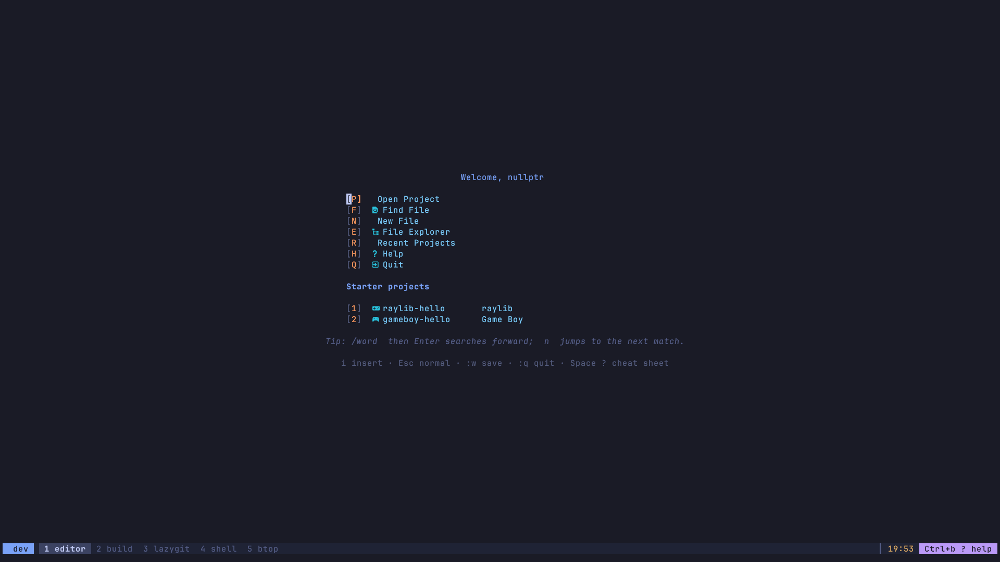
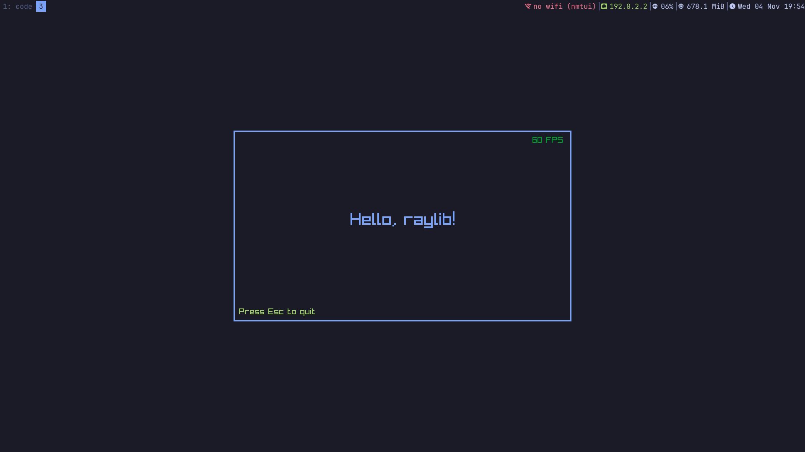
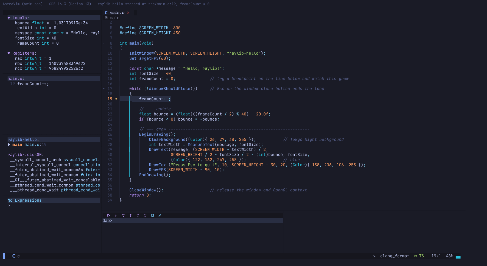
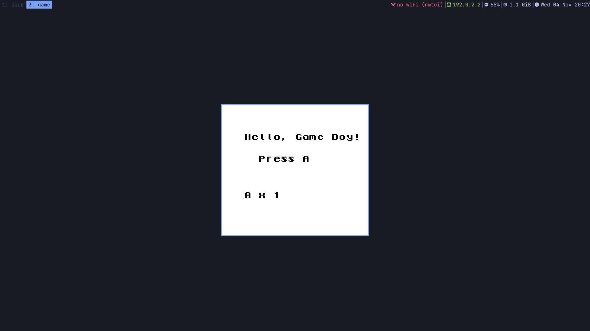

# nullptr Workstation

A small, terminal-first Debian 13 development workstation for C, raylib and Game Boy
(GBDK-2020) development, built as an installable ISO for the **ThinkPad X1 Carbon Gen 6**.

```
log in on tty1 ─► Xorg + i3 ─► kitty (fullscreen, workspace 1) ─► tmux "dev" ─► AstroVim dashboard
```

| Workspace | Purpose |
|---|---|
| `Super+1` | kitty → tmux (`1` AstroVim · `2` build · `3` LazyGit · `4` shell · `5` btop) |
| `Super+2` | LibreSprite (`Super+A` / `art`) |
| `Super+3` | running raylib games and Emulicious |
| `Super+4` | anything else |

> **Status:** the workstation layer is built and tested. The ISO itself has **not** been
> built yet, because the development sandbox could not reach Debian's mirrors. See
> [tests/REPORT.md](tests/REPORT.md) for every result (PASS / FAIL / NOT TESTED) and
> [Build the ISO](#build-the-iso) to produce it.

## Screenshots (from the test run)

| | |
|---|---|
|  |  |
| AstroVim dashboard inside tmux `dev` | `raylib-hello` started with `Space m r` |
|  |  |
| nvim-dap + GDB 16.3 stopped at `main.c:19` | `gameboy-hello.gb` (shown in mGBA: Emulicious was unreachable from the sandbox) |

## Build the ISO

```bash
sudo ./build-iso.sh            # on Debian 13
./build-iso.sh --docker        # on any Linux host with Docker
```

The result is `out/nullptr-workstation-amd64.iso`, plus `.sha256`, `packages.manifest`,
`versions.resolved` and `build.log`. Then follow [docs/installation.md](docs/installation.md).

## What's inside

| Area | Choice | Why |
|---|---|---|
| Base | Debian 13 trixie amd64, `live-build` | as specified |
| Installer | **debian-installer** (live mode), text + graphical, partial preseed | Debian's own, well-tested installer. Only the username is preseeded; password and partitioning are always interactive. Calamares would need a full desktop session in the live image to run. |
| Session | getty → `.bash_profile` guard → `startx` → i3 | no display manager; X never starts for SSH, tmux, nested shells or tty2–6 |
| Terminal | kitty + tmux 3.5 (`Ctrl+b`), session `dev`, windows 1–5 | |
| Editor | Neovim 0.12.6 + **AstroNvim v6.1.1**, 49 plugins pinned by `lazy-lock.json`, offline-ready | Debian's Neovim 0.10 is too old for AstroNvim v6 |
| C | GCC 14, Clang/clangd/clang-format/clang-tidy 19, GDB 16.3, CMake, Ninja (Debian) | |
| raylib | 5.5 from pinned source, X11 | |
| Game Boy | GBDK-2020 4.5.0 (bundled SDCC), Emulicious + OpenJDK 21 | |
| Debugging | nvim-dap → GDB's built-in DAP; nvim-dap → Emulicious's DAP server; fallbacks: VSCodium + Emulicious Debugger, Emulicious's own debugger | |
| Art | LibreSprite 1.2 (source build; 1.3 needs CMake 4.1) + Wacom/libinput tablet stack | |
| Look | Tokyo Night everywhere, JetBrainsMono Nerd Font | |
| Laptop | NetworkManager/nmtui, PipeWire, TLP (only power manager), brightnessctl, i3lock + xss-lock | |

## Repository layout

```
build-iso.sh              ISO build entry point (host or --docker)
versions.lock             pinned non-Debian components (SHA-256 / git commits)
packages/*.list           Debian packages
config/live/              live-build: auto/config, chroot hooks
config/dotfiles/          i3, i3status, kitty, tmux, AstroNvim, lazygit, btop, shell login files
config/system/            /etc and live-config files, post-install script
scripts/bin/              user commands: dev projects code build run-game debug-game art …
scripts/lib/              shared shell library (project detection, build/run/debug)
scripts/sbin/             nullptr-install-emulicious
scripts/install/          install-upstream.sh, install-workstation.sh, nvim-ts-install.lua
templates/raylib|gameboy  project templates (new-raylib / new-gameboy)
installer/preseed.cfg     debian-installer preseed (username only)
docs/                     guides (below)
tests/                    test report, workflow suite, DAP tests, QEMU scripts, screenshots
```

## Documentation

| Guide | |
|---|---|
| [installation.md](docs/installation.md) | build, USB, BIOS settings, installer walkthrough, first boot |
| [first-use.md](docs/first-use.md) | 10-step tutorial and the beginner guide (`helpme`) |
| [keyboard-cheatsheet.md](docs/keyboard-cheatsheet.md) | AstroVim / tmux / i3 shortcuts (`keys`) |
| [tmux.md](docs/tmux.md) | windows, panes, detach/attach for beginners |
| [raylib-guide.md](docs/raylib-guide.md) | C/raylib build and GDB debugging |
| [gameboy-debugging.md](docs/gameboy-debugging.md) | GBDK build, Emulicious, C source debugging and its test status |
| [drawing-tablet.md](docs/drawing-tablet.md) | tablets, `tablet-info`, `tablet-setup`, limitations |
| [recovery.md](docs/recovery.md) | when the graphical session or anything else breaks |
| [licenses.md](docs/licenses.md) | redistribution of bundled software (Emulicious!) |
| [tests/REPORT.md](tests/REPORT.md) | test results |

## Commands

`dev` · `projects` · `code PATH` · `build` · `run-game` · `debug-game` · `art` ·
`new-raylib NAME` · `new-gameboy NAME` · `gb-build` · `gb-run` · `gb-debug` · `gb-clean` ·
`gb-info` · `tablet-info` · `tablet-setup` · `keys` · `helpme`

They are real scripts in `/usr/local/bin`, not aliases. Every command that acts on a project
prints which project it uses, and refuses rather than guesses when your shell's directory and
the active project disagree.
