# nullptr Workstation

A small, terminal-first Debian 13 development workstation for C, raylib and Game Boy
(GBDK-2020) development, built as an installable ISO for the **ThinkPad X1 Carbon Gen 6**.

```
log in on tty1 ─► Xorg + i3 ─► kitty (fullscreen, workspace 1) ─► tmux "dev" ─► AstroVim dashboard
```

| Workspace | Purpose |
|---|---|
| `Super+1` | kitty → tmux (`1` AstroVim · `2` build · `3` LazyGit · `4` shell · `5` btop) |
| `Super+2` | Firefox (`Super+W` / `web`), with a toolbar of raylib, C, GBDK, Tiled and Blender docs |
| `Super+3` | LibreSprite (`Super+A` / `art`) |
| `Super+4` | Tiled map editor (`Super+T` / `tiles`) for tile maps and levels |
| `Super+5` | Blender (`Super+B` / `3d`) for 3D and 2.5D scenes |
| `Super+6` | running raylib games and Emulicious |
| `Super+7` | anything else |

> **Status:** the ISO is built and verified. A fresh install in a UEFI virtual machine
> passed **129/129** automated checks, run as the user would: tty1 login → graphical
> workspace → builds, raylib and Game Boy C debugging, LibreSprite, tty2 recovery console.
> Only laptop hardware (tablet, Wi-Fi, battery, suspend, GPU, keys) remains to be checked on
> the X1 Carbon. Details: [tests/REPORT.md](tests/REPORT.md).

## Screenshots

Real captures of the workstation's session (i3 + kitty + tmux + AstroVim, 1920×1080, the
X1 Carbon's panel size), taken on the test VM. Test evidence is kept separately in
[`tests/screenshots/`](tests/screenshots/).

**Log in → the dashboard.** kitty opens fullscreen on workspace 1, attached to tmux `dev`
(window list at the bottom, active project and clock at the right).

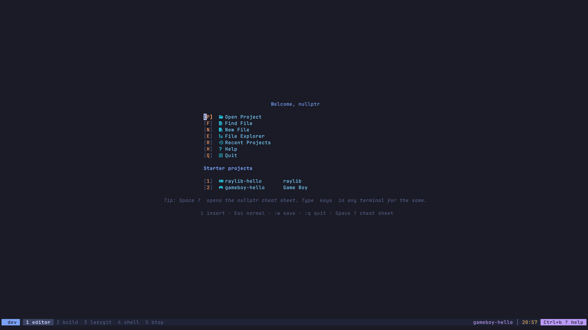

**Edit C with clangd.** Neo-tree on the left, completion with full signatures, git branch,
diagnostics, LSP and treesitter status in the status line.

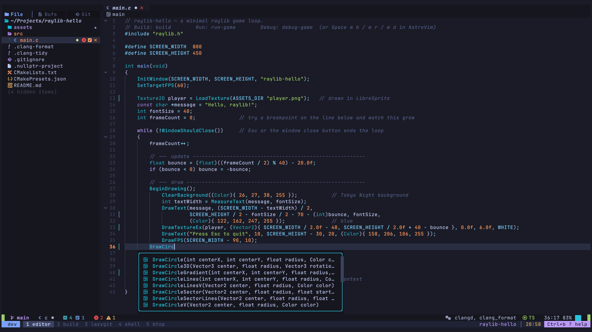

**Build without leaving the editor** (`Space m b`). CMake + Ninja run in a split that follows
the output.

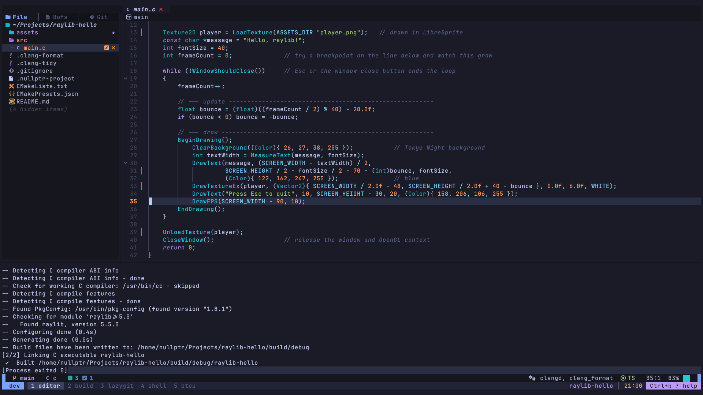

**Run** (`Space m r`). The game opens on workspace `6: game` and draws the sprite from
LibreSprite.

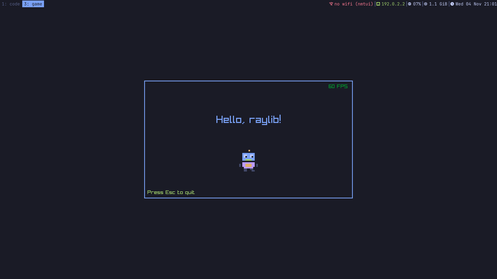

**Debug** (`F9` breakpoint, `F5`). Stopped on `frameCount++;`: locals, call stack,
breakpoints, and the game's log in the console. i3 switched back from the game to the editor
on its own. *(This capture used Debian 13's GDB 16.3 from a container; tmux window `6 debug`
is that test harness.)*

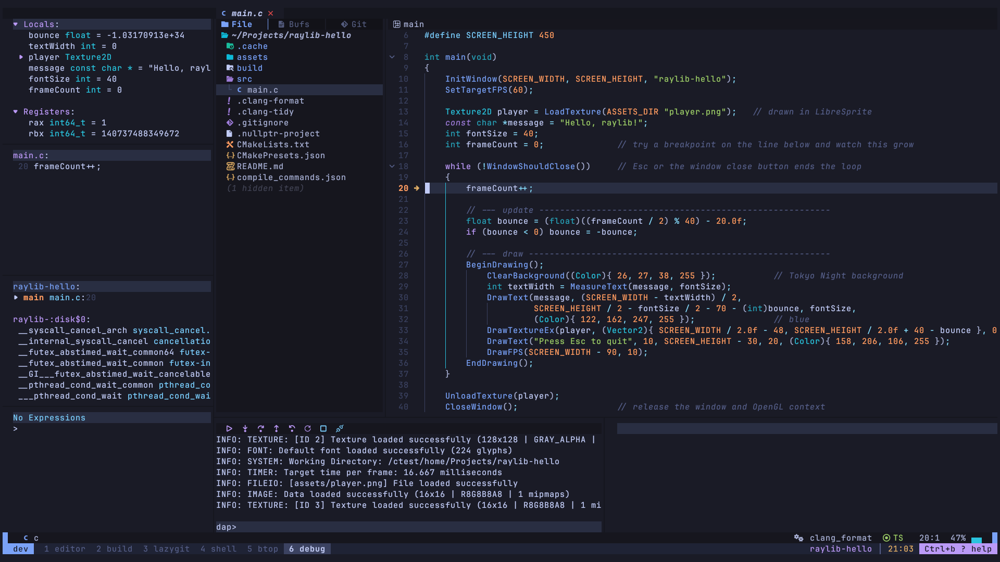

**Game Boy C with GBDK-2020.** clangd completes the GBDK API (the project's `.clangd`
teaches it SDCC's keywords)…

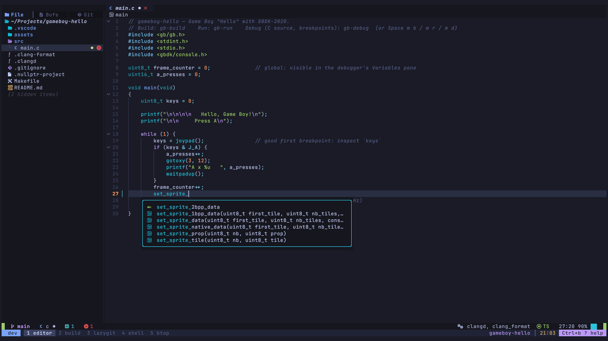

…and `Space m b` builds the ROM with `lcc -debug`, producing the `.cdb` for source-level debugging.

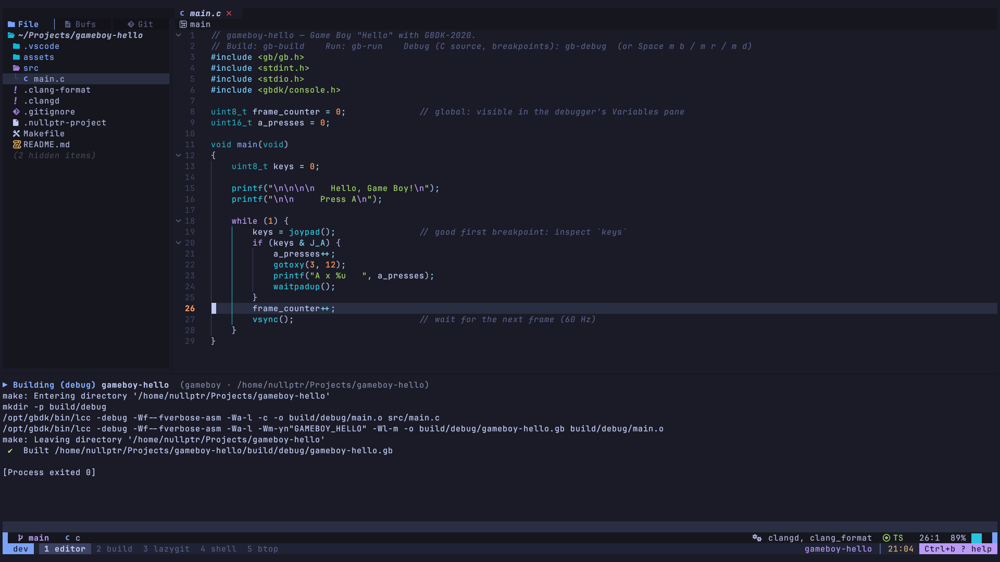

**The ROM running in Emulicious**, on the installed system from the ISO (screenshot from the
automated VM test).

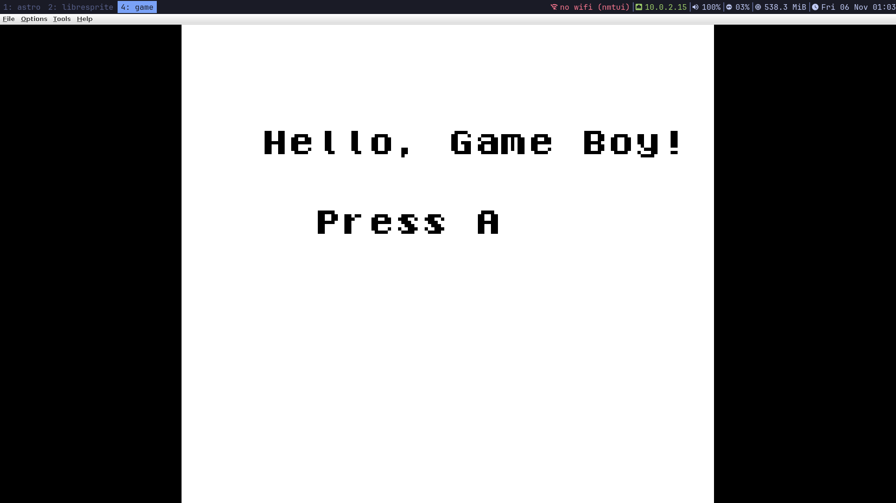

**Pixel art** (`Super+A` / `art`). LibreSprite 1.2 on workspace `3: libresprite`, editing
`assets/player.png`.

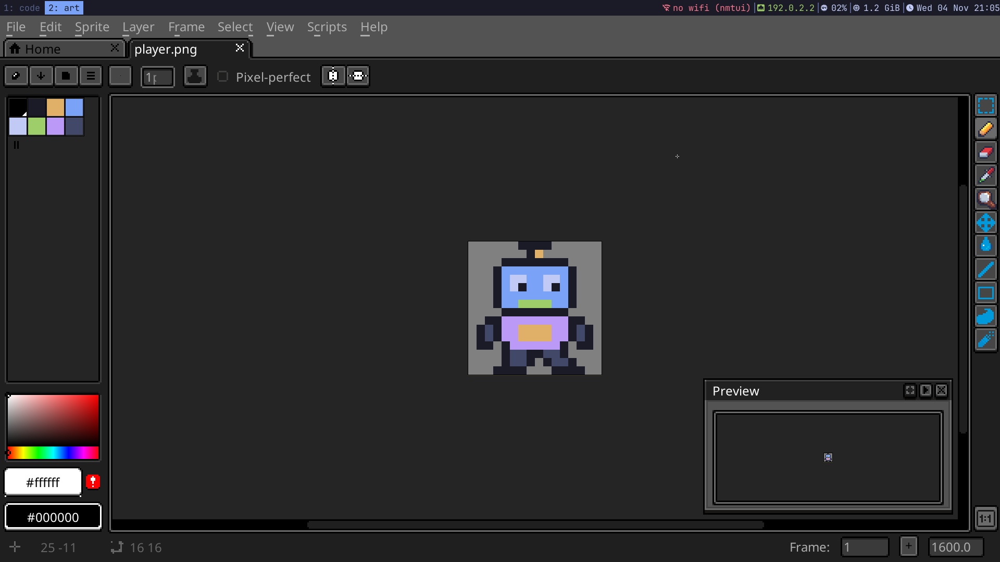

**3D** (`Super+B` / `3d`). Blender on its own workspace `5: blender`, here with a test diorama
that the automated test exports as `.glb` and loads in raylib.

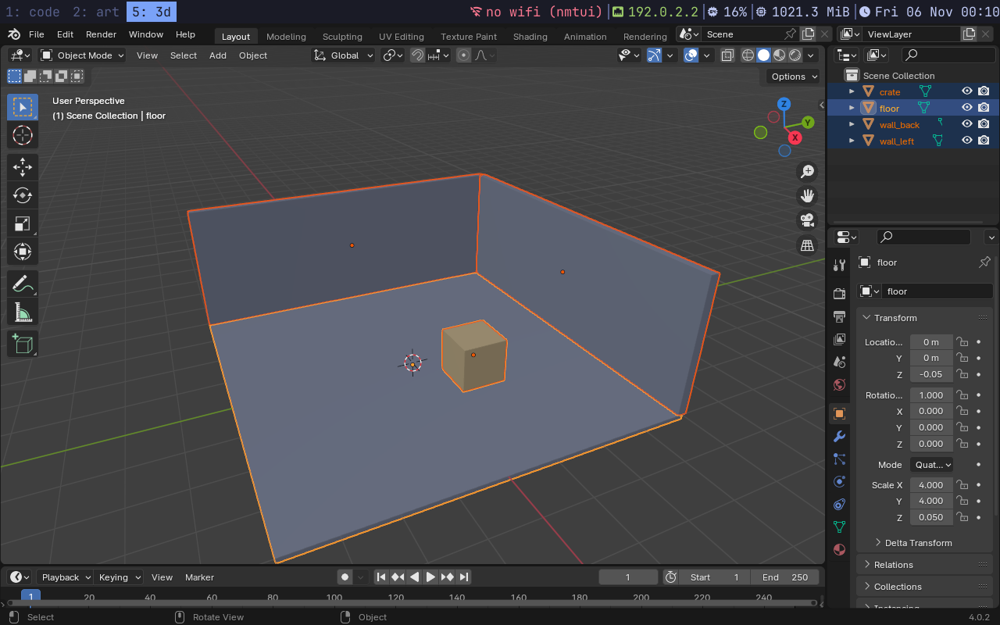

**Tile maps** (`Super+T` / `tiles`). Tiled on workspace `4: tiled` with the test map, a tileset
drawn as a PNG. The automated test exports it to JSON and CSV for the game
([docs/tiled.md](docs/tiled.md)).

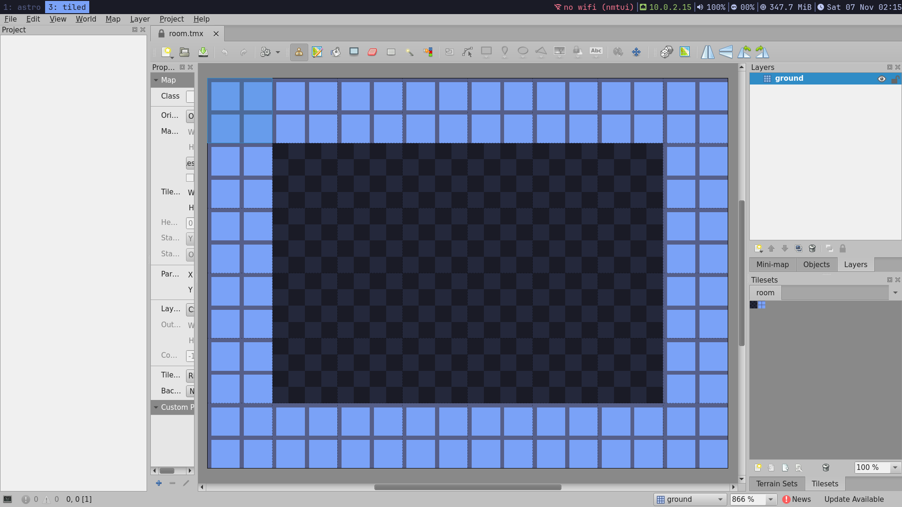

**Docs one key away** (`Super+W` / `web`). Firefox on workspace `2: firefox`, with a toolbar of
the references used here: raylib, C, GBDK, Pan Docs, Tiled, Blender, CMake.

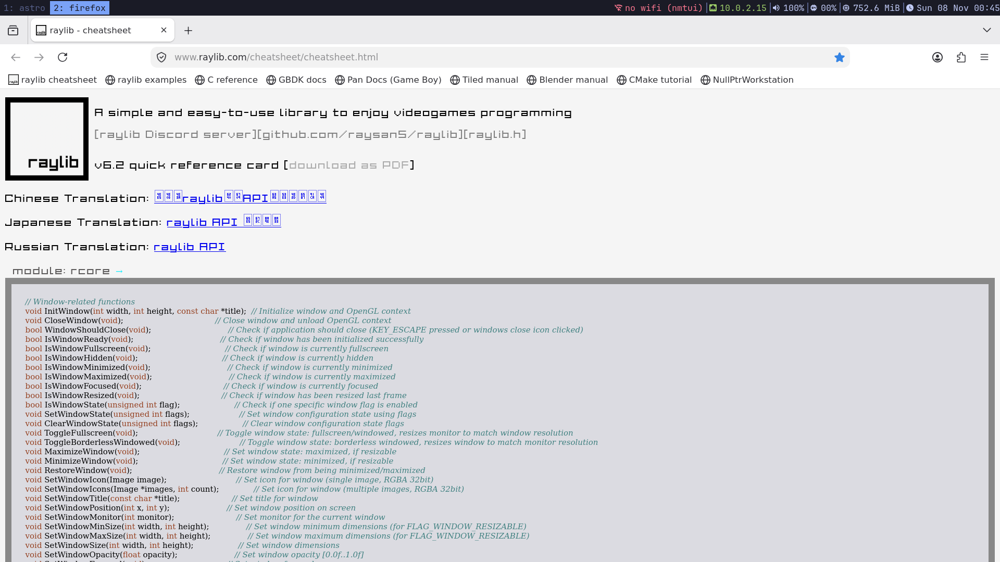

**Git** (`Ctrl+b 3`). LazyGit follows the active project: the new sprite and the code that
uses it.

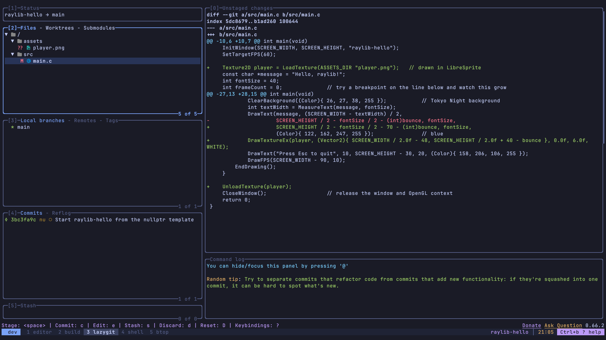

**Help is one key away.** `Ctrl+b ?` (or `Space ?`, `Super+F1`, `keys`).

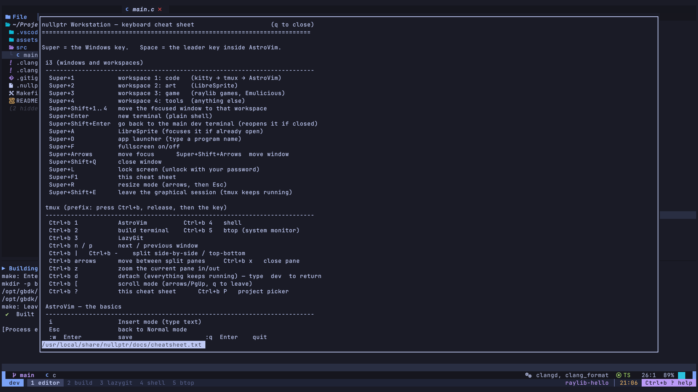

### Straight from the installed ISO

Taken by the automated test in a VM with a fresh installation: the tty1 login, then what
appears right after logging in. Nothing was typed except the user name and password.

| | |
|---|---|
| 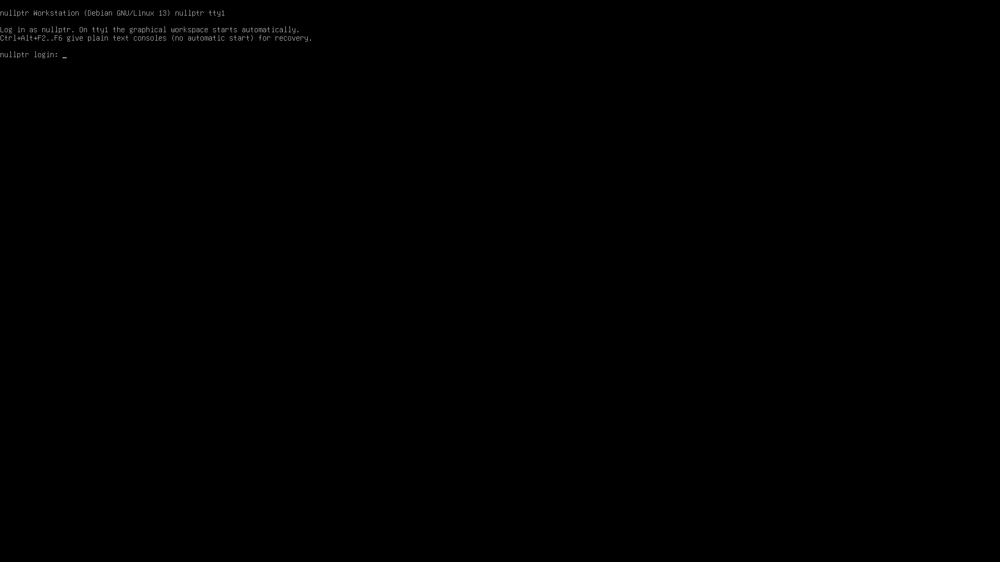 | 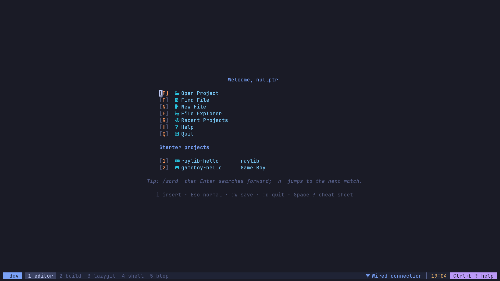 |

## Build the ISO

```bash
sudo ./build-iso.sh            # on Debian 13
./build-iso.sh --docker        # on any Linux host with Docker
```

The result is `out/nullptr-workstation-amd64.iso`, plus `.sha256`, `packages.manifest`,
`versions.resolved` and `build.log`. Then follow [docs/installation.md](docs/installation.md).

## What's inside

| Area | Choice | Why |
|---|---|---|
| Base | Debian 13 trixie amd64, `live-build` | as specified |
| Installer | **debian-installer** (live mode), text + graphical, partial preseed | Debian's own, well-tested installer. Only the username is preseeded; password and partitioning are always interactive. Calamares would need a full desktop session in the live image to run. |
| Session | getty → `.bash_profile` guard → `startx` → i3 | no display manager; X never starts for SSH, tmux, nested shells or tty2–6 |
| Terminal | kitty + tmux 3.5 (`Ctrl+b`), session `dev`, windows 1–5 | |
| Editor | Neovim 0.12.6 + **AstroNvim v6.1.1**, 49 plugins pinned by `lazy-lock.json`, offline-ready | Debian's Neovim 0.10 is too old for AstroNvim v6 |
| C | GCC 14, Clang/clangd/clang-format/clang-tidy 19, GDB 16.3, CMake, Ninja (Debian) | |
| raylib | 5.5 from pinned source, X11 | |
| Game Boy | GBDK-2020 4.5.0 (bundled SDCC), Emulicious + OpenJDK 21 | |
| Debugging | nvim-dap → GDB's built-in DAP; nvim-dap → Emulicious's DAP server; fallbacks: VSCodium + Emulicious Debugger, Emulicious's own debugger | |
| Web | Firefox ESR (Debian) on its own workspace, docs bookmarks toolbar | |
| Files | Thunar (floating, thumbnails, Extract Here, Trash, USB) + `import-assets` for itch.io packs | |
| GitHub | `gh` sign-in through the browser (works with Google sign-in) used by git; no SSH key | |
| Maps | Tiled (Debian) on its own workspace; TMX → JSON/CSV export tested |
| 3D | Blender (Debian) on its own workspace; glTF → raylib pipeline tested | |
| Art | LibreSprite 1.2 (source build; 1.3 needs CMake 4.1) + Wacom/libinput tablet stack | |
| Look | Tokyo Night everywhere, JetBrainsMono Nerd Font | |
| Laptop | NetworkManager/nmtui, PipeWire, TLP (only power manager), brightnessctl, i3lock + xss-lock | |

## Repository layout

```
build-iso.sh              ISO build entry point (host or --docker)
versions.lock             pinned non-Debian components (SHA-256 / git commits)
packages/*.list           Debian packages
config/live/              live-build: auto/config, chroot hooks
config/dotfiles/          i3, i3status, kitty, tmux, AstroNvim, lazygit, btop, shell login files
config/system/            /etc and live-config files, post-install script
scripts/bin/              user commands: dev projects code build run-game debug-game art …
scripts/lib/              shared shell library (project detection, build/run/debug)
scripts/sbin/             nullptr-install-emulicious
scripts/install/          install-upstream.sh, install-workstation.sh, nvim-ts-install.lua
templates/generic|raylib|gameboy  project templates (new-c / new-raylib / new-gameboy)
installer/preseed.cfg     debian-installer preseed (username only)
docs/                     guides (below)
tests/                    test report, workflow suite, DAP tests, QEMU scripts, screenshots
```

## Documentation

| Guide | |
|---|---|
| [installation.md](docs/installation.md) | build, USB, BIOS settings, installer walkthrough, first boot |
| [first-use.md](docs/first-use.md) | 10-step tutorial and the beginner guide (`helpme`) |
| [keyboard-cheatsheet.md](docs/keyboard-cheatsheet.md) | AstroVim / tmux / i3 shortcuts (`keys`) |
| [tmux.md](docs/tmux.md) | windows, panes, detach/attach for beginners |
| [c-projects.md](docs/c-projects.md) | plain C projects, `projects adopt`, custom build/run commands, doing it by hand |
| [raylib-guide.md](docs/raylib-guide.md) | C/raylib build and GDB debugging |
| [gameboy-debugging.md](docs/gameboy-debugging.md) | GBDK build, Emulicious, C source debugging and its test status |
| [files-and-assets.md](docs/files-and-assets.md) | file manager, `import-assets` for itch.io packs, licenses and `CREDITS.md` |
| [git-and-github.md](docs/git-and-github.md) | `github-login` (Google sign-in, no SSH key), putting projects on GitHub, LazyGit |
| [tiled.md](docs/tiled.md) | Tiled workspace, maps and tilesets, getting a map into raylib and GBDK |
| [blender.md](docs/blender.md) | Blender workspace, laptop settings, glTF into raylib, 2.5D approaches |
| [drawing-tablet.md](docs/drawing-tablet.md) | tablets, `tablet-info`, `tablet-setup`, limitations |
| [updating.md](docs/updating.md) | `nullptr-update` (update in place from GitHub) and `nullptr-iso` (GitHub-built ISO → USB → reinstall) |
| [recovery.md](docs/recovery.md) | when the graphical session or anything else breaks |
| [licenses.md](docs/licenses.md) | redistribution of bundled software (Emulicious!) |
| [tests/REPORT.md](tests/REPORT.md) | test results |

## Commands

`dev` · `projects` · `code PATH` · `build` · `run-game` · `debug-game` · `web` · `files` · `import-assets` · `github-login` · `art` · `tiles` · `3d` ·
`new-c NAME` · `new-raylib NAME` · `new-gameboy NAME` · `projects adopt` · `gb-build` · `gb-run` · `gb-debug` · `gb-clean` ·
`gb-info` · `tablet-info` · `tablet-setup` · `keys` · `helpme` · `nullptr-update` · `nullptr-iso`

They are real scripts in `/usr/local/bin`, not aliases. Every command that acts on a project
prints which project it uses, and refuses rather than guesses when your shell's directory and
the active project disagree.
