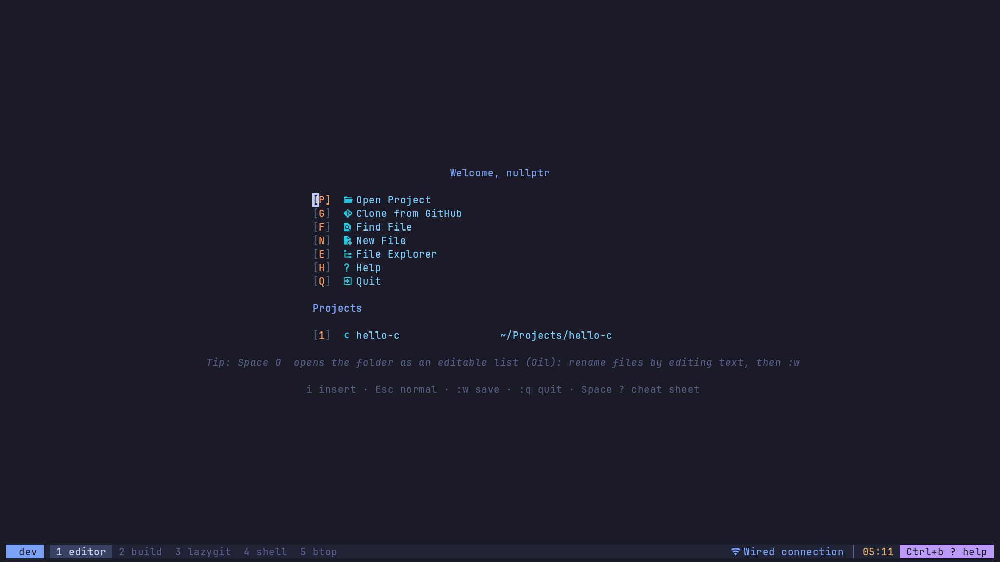
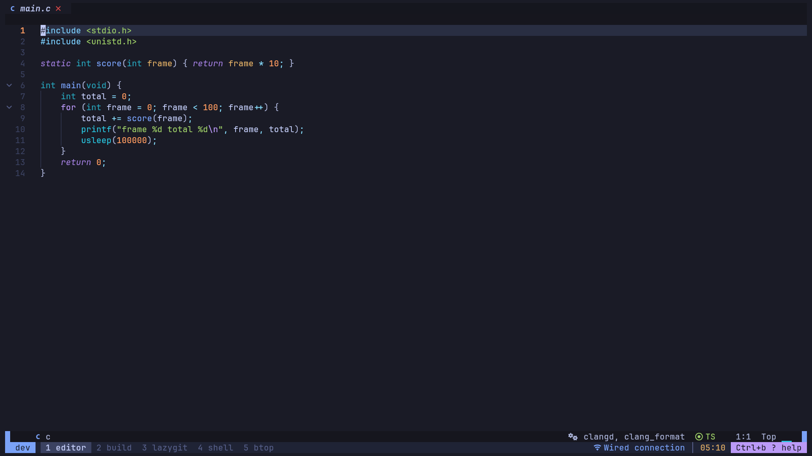
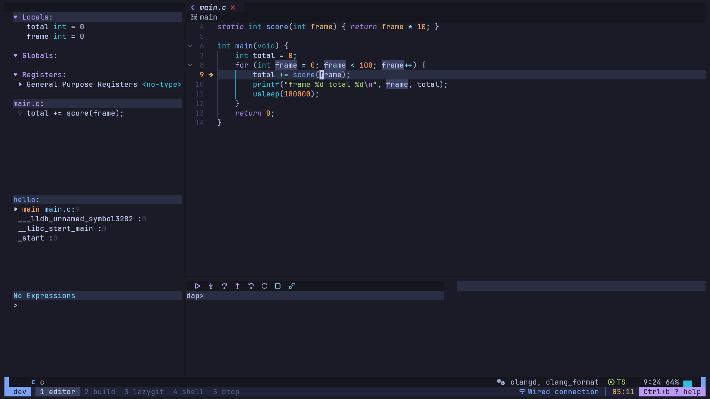
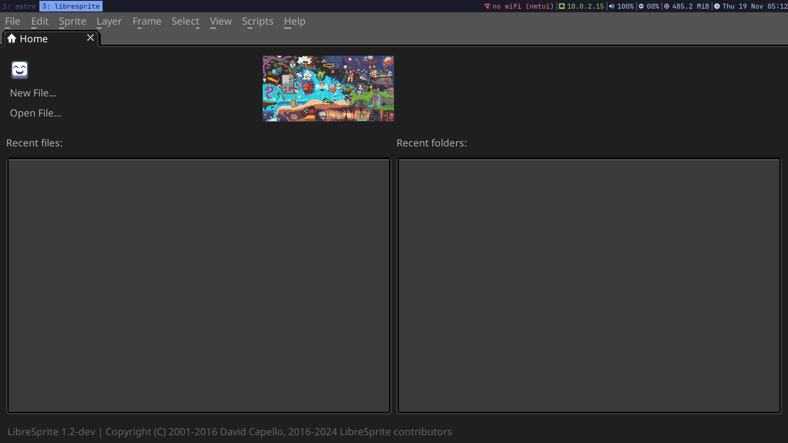
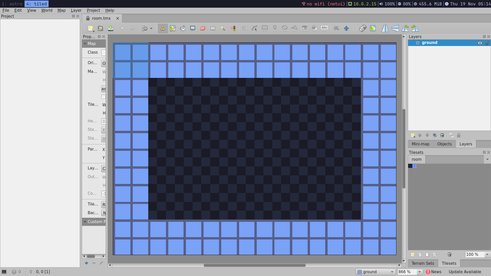
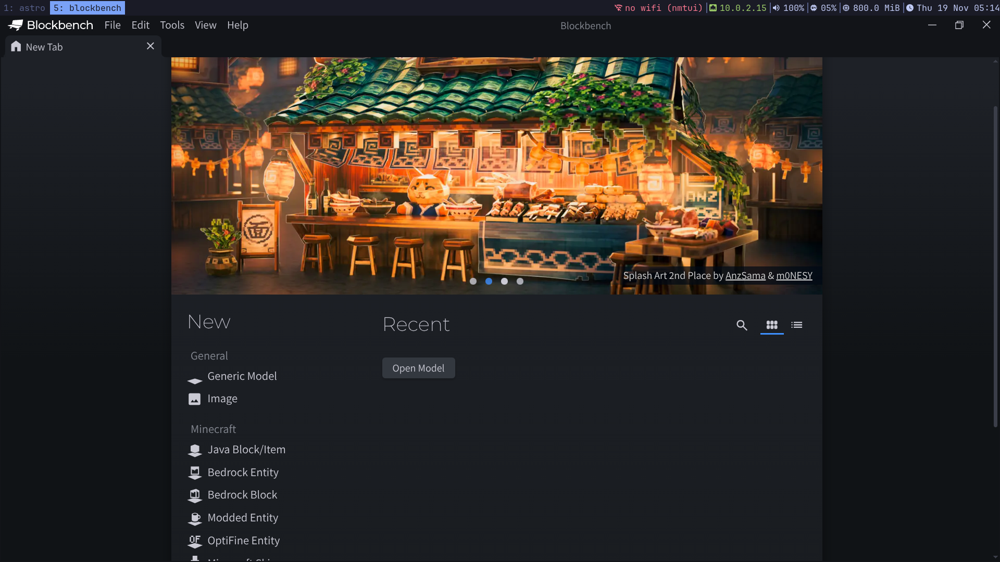
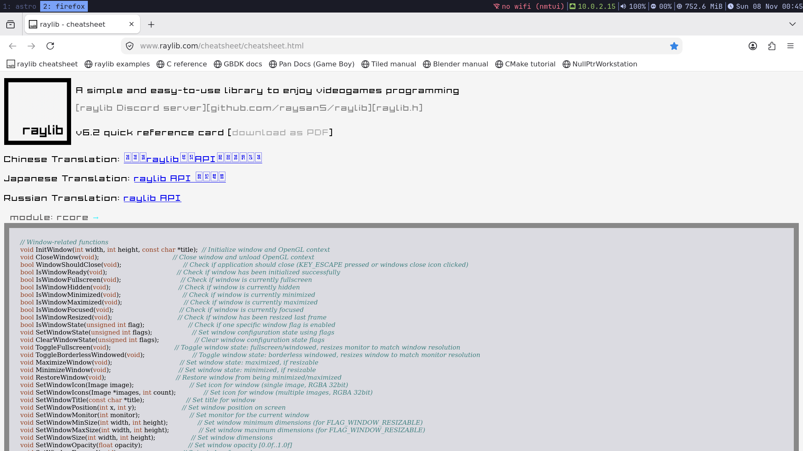
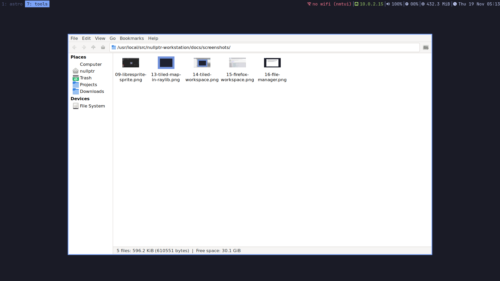
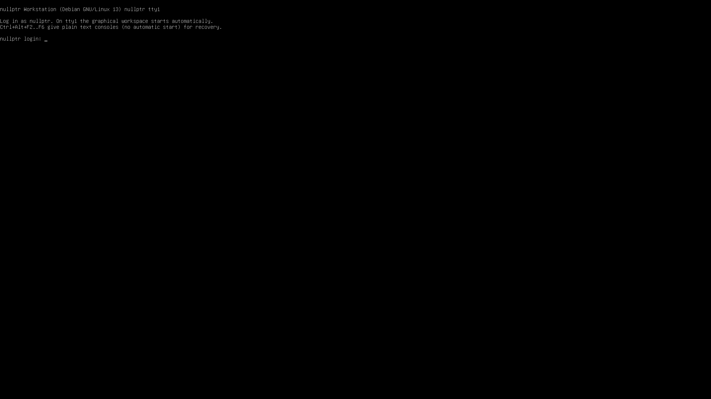
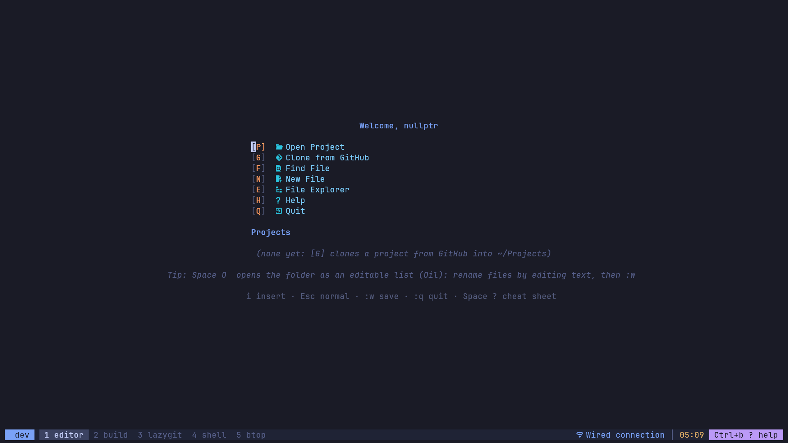

# nullptr Workstation

A small, terminal-first Debian 13 workstation for **C with clang**, built as an installable
ISO for the **ThinkPad X1 Carbon Gen 6**. A fully set-up AstroVim builds, runs and debugs any
C project you clone from GitHub. Nothing is preset: no project templates, and no game libraries
installed system-wide. Each project brings its own libraries and, if it needs to, tells AstroVim
how to build and debug it.

```
log in on tty1 ─► Xorg + i3 ─► kitty (fullscreen, workspace 1) ─► tmux "dev" ─► AstroVim dashboard
```

| Workspace | Purpose |
|---|---|
| `Super+1` | kitty → tmux (`1` AstroVim · `2` build · `3` LazyGit · `4` shell · `5` btop) |
| `Super+2` | Firefox (`Super+W` / `web`), with a toolbar of C, clang, CMake, LLDB and GDB docs |
| `Super+3` | LibreSprite (`Super+A` / `art`) |
| `Super+4` | Tiled map editor (`Super+T` / `tiles`) |
| `Super+5` | Blockbench (`Super+B` / `3d`) for low-poly 3D models |
| `Super+6` | windows of the programs you run: anything started from the editor workspace lands here |
| `Super+7` | anything else |

> **Status:** see [tests/REPORT.md](tests/REPORT.md). Every GitHub build installs the ISO in a
> UEFI virtual machine and runs the checks there, as the user would. Laptop hardware (tablet,
> Wi-Fi, battery, suspend, GPU, keys) can only be checked on the X1 Carbon.

## How C projects work

```
Space m g  clone owner/repo ──► ~/Projects/repo ──► Space m b build ──► Space m r run ──► F5 debug
```

- **Clone:** `Space m g` in AstroVim (or `gh repo clone`), with submodules.
- **Build:** detected from the repository. CMake uses Ninja and a Debug build, and writes
  `compile_commands.json` for clangd. Make runs through `bear`, so clangd understands Make
  projects too.
- **Run:** the program the build produced. Its window opens on workspace 6, and you're back in
  the editor when it closes.
- **Debug:** LLDB (`lldb-dap`). F9 sets a breakpoint, F5 continues, F10/F11 step, and the editor
  comes back whenever execution stops.
- **When a project needs something else** (a GBA emulator, a cross-compiler, another
  debugger), the project says so in its own `.nvim.lua` or `.vscode/launch.json`. AstroVim
  itself never needs editing. [docs/c-projects.md](docs/c-projects.md) has worked examples for
  raylib and SDL3 inside the project, GBA (devkitARM + mGBA's GDB stub) and Game Boy
  (GBDK + Emulicious).
- **clang is the default compiler** (`cc`, `c++`, CMake, make). GCC is still there.

## Screenshots

From the automated test of a fresh installation (1920×1080, the X1 Carbon's panel size).

**Log in → the dashboard.** Clone (`G`), open (`P`, or 1–9 for recent projects), find, help.



**Build without leaving the editor** (`Space m b`): a cloned CMake project, built with Ninja.



**Debug** (`F9`, then `F5`): stopped at a breakpoint in LLDB, with variables, call stack and the
program's output.



**Pixel art, maps, 3D:** LibreSprite (`Super+A`), Tiled (`Super+T`), Blockbench (`Super+B`).





**Docs one key away** (`Super+W`), and **files** (`Super+E`): Thunar floats over the current
workspace with thumbnails. `import-assets pack.zip` unpacks an itch.io pack into the project
and records its license ([docs/files-and-assets.md](docs/files-and-assets.md)).




### Straight from the installed ISO

The tty1 login, then what appears right after logging in. Nothing was typed except the user
name and password.

| | |
|---|---|
|  |  |

## Build the ISO

```bash
sudo ./build-iso.sh            # on Debian 13
```
```bash
./build-iso.sh --docker        # on any Linux host with Docker
```

The result is `out/nullptr-workstation-amd64.iso`, plus `.sha256`, `packages.manifest`,
`versions.resolved` and `build.log`. Or let GitHub build and test it: `nullptr-iso --build`.
Then follow [docs/installation.md](docs/installation.md).

## What's inside

| Area | Choice | Why |
|---|---|---|
| Base | Debian 13 trixie amd64, `live-build` | |
| Installer | **debian-installer** (live mode), text + graphical, partial preseed | Debian's own installer. Only the username is preseeded; password and partitioning are always interactive. |
| Session | getty → `.bash_profile` guard → `startx` → i3 | no display manager; X never starts for SSH, tmux, nested shells or tty2–6 |
| Terminal | kitty + tmux 3.5 (`Ctrl+b`), session `dev`, windows 1–5 | |
| Editor | Neovim 0.12.6 + **AstroNvim v6.1.1**, plugins pinned by `lazy-lock.json`, offline-ready | Debian's Neovim 0.10 is too old for AstroNvim v6 |
| C | **clang 19 (default cc/c++)**, clangd, clang-format, clang-tidy; GCC 14; CMake, Ninja, Make, bear (Debian) | |
| Debugging | nvim-dap → LLDB (`lldb-dap`), GDB 16's built-in DAP, `gdb-multiarch` for other CPUs and remote stubs | |
| Projects | none preset; per-project `.nvim.lua` / `.vscode/launch.json` | you set projects up; AstroVim adapts to them |
| Art / 3D | LibreSprite 1.2 (source build), Tiled (Debian), Blockbench 5.2.2 (upstream .deb), Wacom/libinput tablet stack | |
| Web / files | Firefox ESR with a docs toolbar; Thunar (thumbnails, archives, Trash, USB) | |
| GitHub | `github-login`: the GitHub CLI's browser sign-in (Google works) used by git; no SSH key | |
| Look | Tokyo Night everywhere, JetBrainsMono Nerd Font | |
| Laptop | NetworkManager/nmtui, PipeWire, TLP (only power manager), brightnessctl, i3lock + xss-lock | |

## Repository layout

```
build-iso.sh              ISO build entry point (host or --docker)
versions.lock             pinned non-Debian components (SHA-256 / git commits)
packages/*.list           Debian packages
config/live/              live-build: auto/config, chroot hooks
config/dotfiles/          i3, i3status, kitty, tmux, AstroNvim, lazygit, btop, shell login files
config/system/            /etc and live-config files, post-install script
scripts/bin/              user commands: dev code web art tiles 3d files import-assets …
scripts/lib/              shared shell library
scripts/install/          install-upstream.sh, install-workstation.sh, nvim-ts-install.lua
installer/preseed.cfg     debian-installer preseed (username only)
docs/                     guides (below)
tests/                    test report, workflow + editor suites, VM test scripts, screenshots
```

## Documentation

| Guide | |
|---|---|
| [installation.md](docs/installation.md) | build, USB, BIOS settings, installer walkthrough, first boot |
| [first-use.md](docs/first-use.md) | 10-step tutorial and the beginner guide (`helpme`) |
| [c-projects.md](docs/c-projects.md) | clone, build, run, debug; `.nvim.lua` and `launch.json`; raylib/SDL3, GBA, Game Boy examples |
| [keyboard-cheatsheet.md](docs/keyboard-cheatsheet.md) | AstroVim / tmux / i3 shortcuts (`keys`) |
| [tmux.md](docs/tmux.md) | windows, panes, detach/attach for beginners |
| [git-and-github.md](docs/git-and-github.md) | `github-login` (Google sign-in, no SSH key), putting projects on GitHub, LazyGit |
| [files-and-assets.md](docs/files-and-assets.md) | file manager, `import-assets` for itch.io packs, licenses and `CREDITS.md` |
| [tiled.md](docs/tiled.md) | Tiled workspace, maps and tilesets, getting a map into C |
| [blockbench.md](docs/blockbench.md) | Blockbench workspace, exporting glTF/OBJ for your game |
| [drawing-tablet.md](docs/drawing-tablet.md) | tablets, `tablet-info`, `tablet-setup`, limitations |
| [updating.md](docs/updating.md) | `nullptr-update` (update in place from GitHub) and `nullptr-iso` (GitHub-built ISO → USB → reinstall) |
| [recovery.md](docs/recovery.md) | when the graphical session or anything else breaks |
| [licenses.md](docs/licenses.md) | redistribution of bundled software |
| [tests/REPORT.md](tests/REPORT.md) | test results |

## Commands

`dev` · `code PATH` · `web` · `art` · `tiles` · `3d` · `files` · `import-assets` ·
`github-login` · `tablet-info` · `tablet-setup` · `keys` · `helpme` · `nullptr-update` · `nullptr-iso`

They are real scripts in `/usr/local/bin`, not aliases. There are deliberately no build
commands: use `cmake`, `make` and your project's own scripts, or `Space m` in AstroVim.
