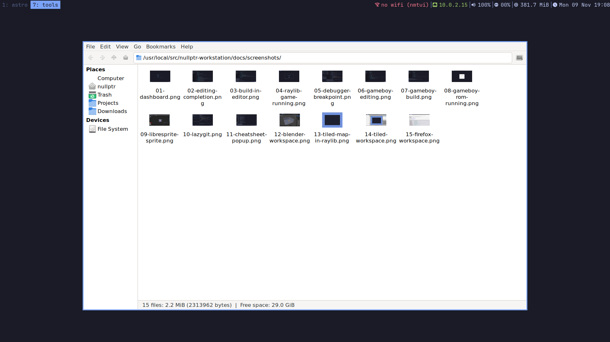

# Files and asset packs

## The file manager



| | |
|---|---|
| `Super+E` or `files` | Thunar, floating over whatever you are doing, opened in the active project's `assets/` |
| `files ~/Downloads` | open a specific folder |
| `F3` (in Thunar) | split view: two folders side by side |
| `Ctrl+H` | show hidden files |
| right-click an archive → **Extract Here** | unpack `.zip`, `.7z`, `.tar.gz` … |

The sidebar has **Projects** and **Downloads**. Images show as thumbnails, so you can tell sprite
sheets apart. Deleted files go to the **Trash**, so mistakes can be undone. USB sticks appear
under *Devices*: click to mount, and eject before pulling them out.

Because Thunar floats, you can drag a PNG from it straight into LibreSprite or Tiled underneath
(press `Super+3` or `Super+4` first, then `Super+E`). Close it with `Ctrl+Q` or `Super+Shift+Q`.

Inside AstroVim you still have the keyboard file managers: `Space e` (Neo-tree) and `Space O`
(Oil: rename and move files by editing text).

## Asset packs from itch.io: `import-assets`

```
Firefox (Super+2)  ──download──►  ~/Downloads/dungeon-tileset.zip
                                         │  import-assets
                                         ▼
                  ~/Projects/kingdom/assets/dungeon-tileset/   +   a line in CREDITS.md
```

```bash
import-assets ~/Downloads/dungeon-tileset.zip --url https://someartist.itch.io/dungeon-tileset
```

What it does:

- Unpacks into the **active project's** `assets/dungeon-tileset/`. Use `--project NAME` for
  another project and `--name NAME` for another folder name.
- **Never overwrites.** If the folder exists, it stops and changes nothing.
- Removes the wrapping folder most zips have (`pack.zip` → `pack/…`) and macOS clutter
  (`__MACOSX`, `.DS_Store`).
- Keeps every file inside `assets/…`: a pack can't write anywhere else, even one with
  `../` paths (tested).
- Counts what came in: images, sounds, maps, fonts.
- Shows the pack's **LICENSE / README / credits** file, and adds a line to the project's
  `CREDITS.md` with the pack name, the `--url` you gave and the license file.

It handles `.zip`, `.7z`, `.tar.gz`/`.tar.xz`/`.tar.bz2` and plain folders. For `.rar`, which
is rare on itch.io, Debian's free 7-Zip may not include the RAR decoder; then unpack it elsewhere.

### Licenses: read them

Most itch.io packs are free to use in your games but **ask for a credit**. CC-BY means "credit
the author". CC0 means no credit is needed, though it's a nice thing to do. Some packs forbid
reselling the assets on their own, or use in NFT/AI training. `CREDITS.md` is where you collect
the credits for your game's credits screen or store page. If a pack has no license file,
`import-assets` says so; check the pack's page before you publish anything that uses it.

### Using the assets

- **Sprites and tilesets** → LibreSprite (`art assets/dungeon-tileset/tiles.png`) or Tiled
  (*New Tileset* from the PNG, see [tiled.md](tiled.md)).
- **In raylib:** `LoadTexture("assets/dungeon-tileset/tiles.png")`. Paths are relative to the
  project root, which is where `run-game` starts the game.
- **Sounds:** `.wav`/`.ogg` load with `LoadSound` / `LoadMusicStream`.
- **Game Boy:** packs made for the Game Boy (4 colours, 8×8 tiles) convert with `png2asset`.
  Most packs aren't; they need re-drawing in 4 colours.
