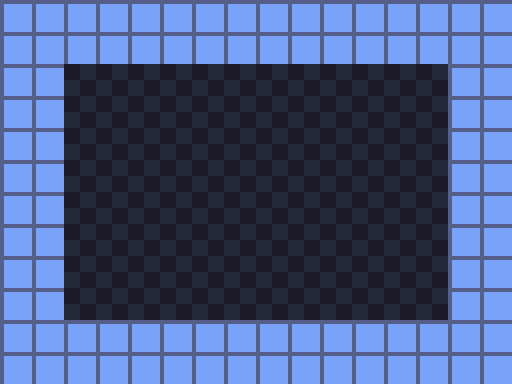

# Tiled: tile maps and levels

[Tiled](https://www.mapeditor.org/) draws levels out of tiles: rooms, dungeons, overworlds.
You paint tiles from a tileset image (made in LibreSprite) onto a grid. It also places
objects such as doors, spawn points and collision boxes.

Tiled has its own workspace, between LibreSprite and Blender:

| | |
|---|---|
| `Super+3` | workspace **3: tiled** (Tiled always opens here) |
| `Super+T`, `tiles` or `Space m t` | focus Tiled, or start it if it isn't running (never a second copy) |
| `tiles room.tmx` | open a specific map (in the window that is already open) |

`tiles` starts Tiled in the active project's `assets/` folder. Keep maps (`.tmx`), tilesets
(`.tsx`) and the tileset images together there, because the paths inside a map are relative.

## The pipeline

```
LibreSprite (Super+2)        Tiled (Super+3)                  your game (Super+5)
tiles.png  ───────────────►  room.tmx  ──export──►  room.csv / room.json  ──►  raylib / GBDK
16×16 tiles in a grid        paint the level         numbers per cell          draw the tiles
```

1. **Draw a tileset** in LibreSprite: one PNG with all tiles in a grid, for example 16×16 pixels
   each (8×8 for the Game Boy). Save it into `assets/`.
2. **New tileset** in Tiled: *File ▸ New ▸ New Tileset…*, *Based on Tileset Image*, pick the PNG
   and set the tile width and height. Save it as `assets/tiles.tsx`.
3. **New map**: *File ▸ New ▸ New Map…*, Orthogonal, the same tile size, map size in tiles
   (for example 20×15). Paint with the stamp tool (`B`), fill (`F`), erase (`E`).
4. **Save** as `assets/room.tmx`, then export (below).

Use **layers** for things that draw on top of each other (ground, walls, decoration), and an
**object layer** for things that aren't tiles (spawn points, doors, trigger areas).

## Exporting

Your game shouldn't parse TMX (XML) itself. Export a simpler format, from *File ▸ Export As…*
or from the command line, which also works in a build script:

```bash
tiled --export-map csv  assets/room.tmx assets/room.csv     # one .csv per tile layer
tiled --export-map json assets/room.tmx assets/room.json    # everything, incl. objects
tiled --export-formats                                      # list every format
```

In the text console (no graphical screen) put `QT_QPA_PLATFORM=offscreen` in front.

⚠️ **The two formats number tiles differently**, a classic off-by-one:

| | first tile | empty cell |
|---|---|---|
| CSV | `0` | `-1` |
| JSON (and TMX) | `1` (the tileset's `firstgid`) | `0` |

So in JSON, subtract `firstgid` to get the tile's position in the tileset.

## Into raylib: CSV, about 40 lines of C

CSV is the easiest start: one number per cell, read with `fscanf`. This loads a map and draws
it. The automated test's map (8×6 tiles, walls around a floor) looks like this:



```c
#include "raylib.h"
#include <stdio.h>

#define MAP_W 8
#define MAP_H 6
#define TILE 16

// Reads a layer exported with: tiled --export-map csv room.tmx room.csv
// Each number is a tile index in the tileset (0 = first tile, -1 = empty cell).
static int LoadMapCsv(const char *path, int map[MAP_H][MAP_W]) {
    FILE *f = fopen(path, "r");
    if (!f) return 0;
    for (int y = 0; y < MAP_H; y++)
        for (int x = 0; x < MAP_W; x++)
            if (fscanf(f, "%d,", &map[y][x]) != 1) { fclose(f); return 0; }
    fclose(f);
    return 1;
}

int main(void) {
    int map[MAP_H][MAP_W];
    if (!LoadMapCsv("assets/room.csv", map)) { TraceLog(LOG_ERROR, "cannot read assets/room.csv"); return 1; }

    InitWindow(MAP_W * TILE * 4, MAP_H * TILE * 4, "tilemap");
    Texture2D tiles = LoadTexture("assets/tiles.png");
    int columns = tiles.width / TILE;                  // tiles per row in the tileset image
    SetTargetFPS(60);

    while (!WindowShouldClose()) {
        BeginDrawing();
        ClearBackground(BLACK);
        for (int y = 0; y < MAP_H; y++) {
            for (int x = 0; x < MAP_W; x++) {
                int t = map[y][x];
                if (t < 0) continue;                   // empty cell
                Rectangle src = { (float)(t % columns * TILE), (float)(t / columns * TILE), TILE, TILE };
                Rectangle dst = { (float)(x * TILE * 4), (float)(y * TILE * 4), TILE * 4, TILE * 4 };
                DrawTexturePro(tiles, src, dst, (Vector2){ 0, 0 }, 0.0f, WHITE);
            }
        }
        EndDrawing();
    }
    UnloadTexture(tiles);
    CloseWindow();
    return 0;
}
```

The map size is fixed in this example. When you need several layers, objects, or maps of any
size, switch to the JSON export and a small single-header parser such as
[cute_tiled.h](https://github.com/RandyGaul/cute_headers). Copy it into your project like any
other source file. The workstation doesn't install one, so you choose.

To re-export automatically on every build, add a custom command to `CMakeLists.txt`:

```cmake
add_custom_command(
  OUTPUT  ${CMAKE_SOURCE_DIR}/assets/room.csv
  COMMAND ${CMAKE_COMMAND} -E env QT_QPA_PLATFORM=offscreen
          tiled --export-map csv ${CMAKE_SOURCE_DIR}/assets/room.tmx ${CMAKE_SOURCE_DIR}/assets/room.csv
  DEPENDS ${CMAKE_SOURCE_DIR}/assets/room.tmx)
add_custom_target(maps DEPENDS ${CMAKE_SOURCE_DIR}/assets/room.csv)
add_dependencies(${PROJECT_NAME} maps)
```

## Into a Game Boy ROM

The Game Boy draws its background from **8×8 tiles**, up to 256 in VRAM, on a 32×32 tile map
(the screen shows 20×18). Make the Tiled map with 8×8 tiles, at most 32×32. Then:

- Convert the tileset PNG to tile data with GBDK's `png2asset` (`/opt/gbdk/bin/png2asset`), as
  the starter project does for its graphics.
- Turn the CSV export into a C array: the numbers are already 0-based tile indexes, so they can
  go straight into `set_bkg_tiles(0, 0, W, H, room_map)` as long as the tiles are loaded into
  VRAM in the same order as in the tileset.

```bash
{ echo "const unsigned char room_map[] = {"; paste -sd, assets/room.csv; echo "};"; } > src/room_map.c
```

`paste -sd,` joins the rows with commas (Tiled's CSV rows don't end in one). There must be no empty cells (`-1`) for the Game Boy; fill the whole map. *This Game Boy path is
described, not yet covered by the automated test.*

## Versions and tests

Tiled 1.11.0 comes from Debian 13 and is updated with the system (`sudo apt upgrade`). Ignore
Tiled's own *Update Available* notice in its status bar: that points to the download for
Windows/macOS. The automated VM test opens Tiled on workspace 3 and exports a map to JSON and CSV
from the command line, checking every cell. The raylib example above was compiled and run with
raylib 5.5.
